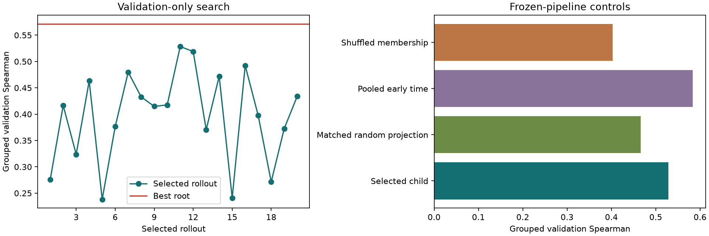

# T47D Lineage Harness: First-Stage Report

Stop reason: no improvement for 12 selected rollouts after minimum 20
Clones: 46; held-out clones: 10.
Formal roots: 5; selected rollouts: 20.
Reward: five-seed mean grouped OOF Spearman; test was opened after frozen selection.

| Candidate | Validation Spearman | Locked-test ensemble Spearman |
|---|---:|---:|
| root_2_ridge | 0.5715 | 0.4895 |
| root_4_pls__pls__ef4e4c0da8 | 0.5284 | 0.3391 |

## Limits

- Relative clone selection is not absolute growth, clinical resistance, or causal state reversal.
- Endpoint non-detection is not proof of extinction. Cohort uses baseline-only eligibility.
- Validation-based search is subject to selection optimism; test has only ten independent clone groups.
- Hallmark scoring is mean log expression, not an exact replication of the paper's R workflow.
- At search freeze, paper-reference extensions and follow-up analyses were not complete. The follow-up below records which analyses were subsequently added; no proxy is counted as a paper method.
- Framework completion and scientific superiority are separate outcomes.

## Search Tree

```mermaid
flowchart TD
  n0["frequency / expression / rho 0.543"]
  n1["ridge / pathway / rho 0.571"]
  n2["elastic / expression / rho 0.489"]
  n3["pls / pathway / rho 0.517"]
  n4["xgboost / expression / rho 0.436"]
  n5["gru / pca / rho 0.416"]
  n1 --> n5
  n6["gru / pathway / rho 0.463"]
  n1 --> n6
  n7["transformer / expression / rho 0.276"]
  n1 --> n7
  n8["gated_residual / expression / rho 0.324"]
  n1 --> n8
  n9["gru / both / rho 0.241"]
  n0 --> n9
  n10["gated_residual / pathway / rho 0.472"]
  n0 --> n10
  n11["gated_residual / pca / rho 0.415"]
  n0 --> n11
  n12["gru / pathway / rho 0.371"]
  n0 --> n12
  n13["gated_residual / pca / rho 0.480"]
  n0 --> n13
  n14["gru / pca / rho 0.433"]
  n0 --> n14
  n15["ridge / both / rho 0.376"]
  n0 --> n15
  n16["transformer / both / rho 0.238"]
  n0 --> n16
  n17["elastic / pca / rho 0.434"]
  n3 --> n17
  n19["elastic / pathway / rho 0.519"]
  n3 --> n19
  n21["ridge / pathway / rho 0.373"]
  n3 --> n21
  n22["pls / pathway / rho 0.528"]
  n3 --> n22
  n24["xgboost / pca / rho 0.418"]
  n3 --> n24
  n50["transformer / pathway / rho 0.492"]
  n22 --> n50
  n52["pls / expression / rho 0.398"]
  n22 --> n52
  n53["transformer / both / rho 0.271"]
  n22 --> n53
```

## Sources

- https://www.ncbi.nlm.nih.gov/geo/query/acc.cgi?acc=GSE260703
- https://github.com/Genentech/TraCSED
- https://pmc.ncbi.nlm.nih.gov/articles/PMC11723929/
- https://data.broadinstitute.org/gsea-msigdb/msigdb/release/2025.1.Hs/h.all.v2025.1.Hs.symbols.gmt

## Frozen-Pipeline Follow-Up

No search was resumed and no candidate was promoted using test or Month-6 observations.
See matched_artifact_controls.json, pseudocount_sensitivity.json, long_term_escape_report.json, combination_suppression.csv, and root_dominance_audit.json.
Five frozen Ridge/PLS seed refits are deterministic, not independent biological replications.
A separate exploratory denominator-coupling diagnostic shuffles endpoint fractions while retaining baseline abundance. Relative-selection predictability must not be equated with independent future-fate prediction.
Eight-ablation applicability is explicitly recorded, including three controls that do not apply to the selected model/task.
