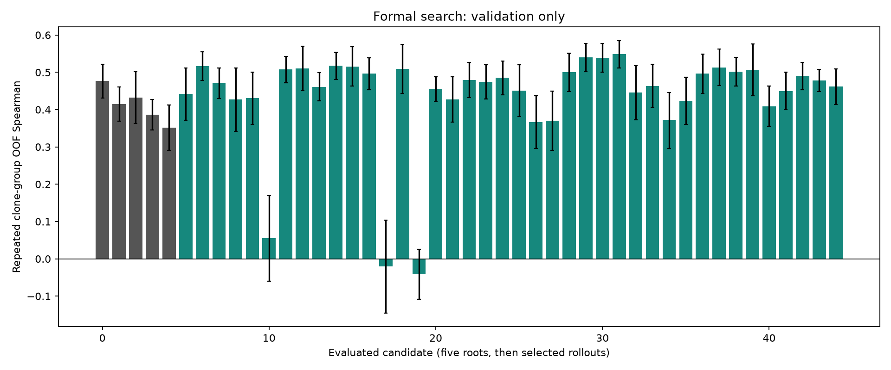
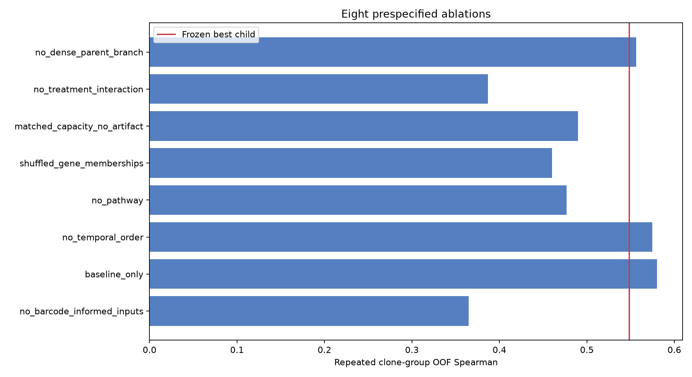
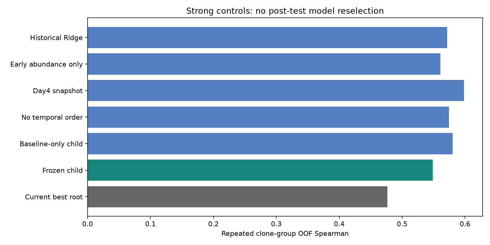
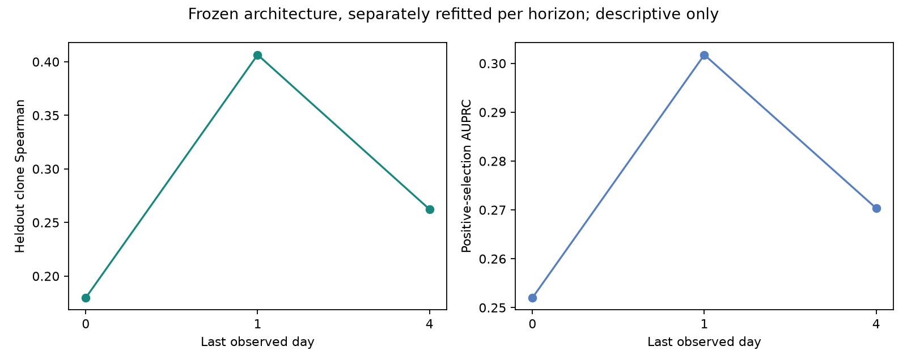
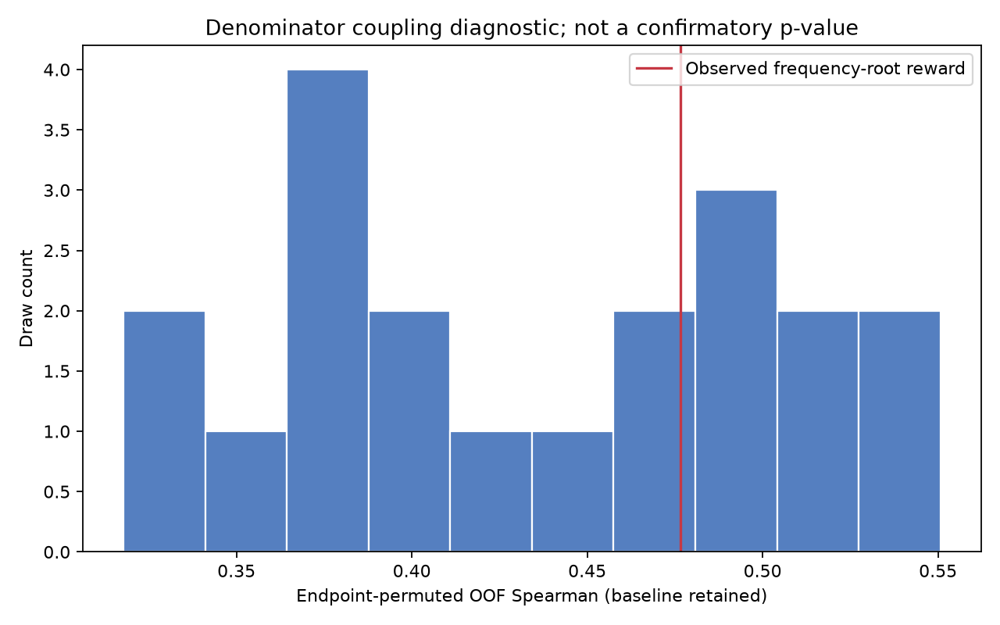

# T47D 谱系耐药完整 Demo：正式实验报告

生成时间：2026-11-06T12:57:14.420964+00:00
原文档范围全部完成：**True**。完成矩阵见 `completion_matrix.json`，未执行项目不会被勾选。

## 研究与证据边界

用真实 GSE260703 TraCe-seq 数据，预测同一克隆在 giredestrant、palbociclib 和联合处理下第 26 天的相对选择。输入仅为第 0、1、4 天；标签为预注册 eps=1e-5 的 log2 终点／基线频率比。
这不是患者疗效、绝对增长率或单细胞状态逆转的证明。相对丰度受群体组成影响；未检出不等于生物学灭绝。
**重要：同一批 heldout 克隆在先前 pilot 已报告过。此次架构选择仅使用开发集 OOF 分数，但不能将这组 test 再称为全新盲测或外部生物学复现。**

## 数据与分组

- 原始矩阵：200,429 cells × 58,302 genes；表达 QC 通过 79,535，唯一条码且通过 QC 47,718。
- 基线至少 10 个细胞的 46 个克隆；开发集 36、保留组 10；合计 138 个 clone×treatment 预测单位。
- clone ID、时间、处理、文库、GEO replicate 标签均保留。文库不等于独立生物学重复，详见混杂审计。
- 所有监督分组以 clone 为单位；5 seeds × 3 folds，共 15 次拟合产生每个候选的正式 reward。
- 基因选择、标准化、PCA/scVI、伪时间、距离参照及 CellRank 核均只用相应训练克隆拟合。

## 搜索与模型范围

5 roots；40 个正式 selected rollouts；159 个生成 proposal。完整结果见 `trained_node_catalog.csv`。
107 个可执行结构模板，覆盖文档的全部表征、动力学、交互、head 和 loss。预先声明的模块覆盖需求先保证每种方法得到正式评估，之后以 UCT parent selection 和全局队列继续搜索；artifact 是否 present 不加科学优先级。
node-local model.py 是实际执行入口；保留 parent 的预测，再拟合训练残差。只有完整 15 折 reward 的 trained 节点才 backprop。每次完成 rollout 后重新生成候选。队列全局容量 48，pruned 不训练。
作者 TraCSED 函数从公开 notebook 提取并保存 hash：正式 early-forecast adapter 使用其真实架构；另外完整运行 R PLSR/Slingshot 与 seq8 retrospective reference，二者分开报告。

## 原方法参考复现

R 预处理状态：complete；TensorFlow／线性参考已完成拟合 464 次。各模式计数：{'full': 116, 'no_attention': 116, 'no_feedforward': 116, 'linear_reference': 116}。
R 使用作者规则的 count>3 基因过滤、30-component PLSR、Leiden 网格、Slingshot、相邻实时时间 KS 和六细胞平滑。private SCE、内部 gene-set revision 与不可移植 cluster IDs 均明确记录重建差异，不能声称逐数值复现。
TensorFlow 保留作者实际 build_model 的计算图，包括重复块和 channels_first pooling 的原代码行为；20 epochs、seq8、40 heads、head size5、ff_dim5、Dense256，以及 no-attention/no-feedforward/线性对照。
这些 retrospective prefix-window 分数有同克隆窗口依赖和伪时间 hindsight，不能与早期→day26 heldout-clone Spearman 混作同一个 benchmark。



## Best Root 与 Generated Child

| 模型 | 重复 OOF Spearman | seed 标准差 | 保留克隆 Spearman | 保留克隆 MAE |
|---|---:|---:|---:|---:|
| root_0_frequency | 0.4765 | 0.0454 | 0.1577 | 2.5597 |
| n79_early_elastic_8cdddb50 | 0.5485 | 0.0368 | 0.2623 | 2.4517 |

Child-root validation 差值：+0.0720；5 个配对 seed 中超过 root：4/5。
95% CI 以 clone block bootstrap 计算，保留同一克隆的全部处理。分类 AUPRC/AUROC、NDCG、Brier/ECE 和联合抑制正确率详见 `frozen_test_metrics.json`；概率校准仅拟合开发 OOF。
Root test Spearman 95% CI：[-0.22637554035951327, 0.5523257050266663]；child：[-0.07528939959989212, 0.5609125606227982]。区间均跨零，不能依据点估计声称可靠的未见克隆预测。

### 更强历史基线复测

先前冻结的 pilot Ridge 在相同克隆合同上复测：OOF Spearman 0.5715、test Spearman 0.4895。它仍强于本轮 frozen child，不能被本轮五个较弱 roots 的比较掩盖。
差异追踪到 treatment 编码及标准化：pilot 使用标准化三类处理 covariates，本轮为组合外推采用两个化学存在指示量。正则化基线对此敏感，因此仅超过本轮 roots 不等于改进了历史最强基线。
这项复测只作冻结后的诊断，不回填 MCTS、不改变胜出模型。下一版框架必须把强基线输入编码/缩放也作为不可悄然更改的比较合同。

## 八项消融



| 消融 | 重复 OOF Spearman | 相对原 child |
|---|---:|---:|
| no_barcode_informed_inputs | 0.3649 | -0.1835 |
| baseline_only | 0.5804 | +0.0319 |
| no_temporal_order | 0.5747 | +0.0262 |
| no_pathway | 0.4768 | -0.0716 |
| shuffled_gene_memberships | 0.4600 | -0.0885 |
| matched_capacity_no_artifact | 0.4898 | -0.0586 |
| no_treatment_interaction | 0.3868 | -0.1617 |
| no_dense_parent_branch | 0.5563 | +0.0078 |



额外对照均正式做 15 折：day4 单快照 0.5981；仅早期丰度 0.5609。两者都高于完整 child。
因此“动态模型优于单快照”和“早期表达模型优于丰度”的预期未获支持。真实通路相较打乱或同宽随机投影的增益，只能解读为局部结构贡献，不能推出整体模型优越性。

无条码输入消融仍保留真实条码作为标签与分组依据，但预测特征只用训练克隆的处理条件均值，删除克隆丰度；不是破坏 ground truth。打乱通路用全局基因置换，保持集合大小与重叠；不是简单换列名。matched-capacity control 保持各层表示宽度。去 dense parent 同时移除继承预测及神经内部 dense 分支。

## 五层评估

1. 开发集 repeated clone-group CV：每个正式候选 15 fits。
2. 冻结模型选择后的 46-clone LOCO：完整数据的次级跨拟合，不代替主保留组评估。
3. late holdout：仅以 day8 selection 训练、day26 作未见终点，输入最高 day4。
4. monotherapy→combination：训练不读取联合监督标签；用独立化学指示量 [1,1] 表达组合。
5. Month6：冻结早期预测、AFT persistence 与探索性吸引子评分后，核对所有已观察到的长期克隆。
早期预警按 day0/day1/day4 分别重拟合，报告 lead time 与 AUPRC，而非用 day4 模型伪称 day1 预警。



LOCO 和挑战任务的完整指标见 `loco_results.json` 与 `challenge_metrics.json`。LOCO 使用全部 46 个克隆作次级跨拟合，不能冒充从未使用 test 克隆训练的主协议；early-warning 各 horizon 均为五 seed 均值。

| 冻结后的评估 | Spearman | MAE |
|---|---:|---:|
| Root：46-clone LOCO | 0.4610 | 2.4422 |
| Child：46-clone LOCO | 0.5262 | 2.2880 |
| Child：day8 supervision → day26 | 0.2799 | 1.8278 |
| Child：单药训练 → 联合 query | 0.1758 | 3.0774 |

## 联合抑制与生物学解释

观测到单药正选择、联合负选择的克隆：5 / 9 个单药正选择克隆。
本预注册 46-clone 队列中正选择克隆数：giredestrant=7、palbociclib=6、combination=12。联合组并不更少，因此不能宣称在此队列复现了‘联合普遍降低相对选择’。
这一 baseline-qualified 队列及全体 QC 单条码细胞分母不同于作者 trajectory/selection 筛选后的克隆集合；相对选择也不等于总细胞杀伤。保留差异，不为靠近论文方向而更改资格或分母。
ER／E2F／EMT 的 clone-paired 动态差异及 bootstrap CI 见 `paired_pathway_comparisons.csv`。所有比较为描述性、存在幸存者偏倚与多重比较，不把 nominal p 值当作临床机制证明。
原文 raw-ratio suppression 与变换后的 log2 差值分开计算，不混淆两种量纲。eps=1e-6/1e-5/1e-4 与 endpoint 未检出敏感性已记录。

## 分母耦合诊断



保留基线频率、在处理内置换终点频率的 20 次诊断（300 次正式折拟合）：均值 0.4350；原频率 root 0.4765。基线同时进入输入与 log-ratio 分母，会产生可预测相关，不能把相关系数全部解释为耐药机制。该后选择诊断不是确认性 p 值。

## 长期逃逸与吸引子评分

RAS 权重预先固定为 .40/.25/.20/.15，标准化及负选择克隆参照仅来自开发集；query 不读取自己的未来标签或未来表达。persistence 为真实区间删失 AFT 从训练终点拟合后的 day180 尾部外推，只能探索。
保留组可评估长期阳性克隆数：0；未见克隆逃逸 recall：None。
若保留组没有阳性，则 recall 不可识别；不能把开发集中的长期优势克隆排得靠前写成 100% 泛化。基线不足的长期稀有条码单独列出，不伪造早期输入。

## 审计与成本

Guardrails：{'fallback': 0, 'proxy': 0, 'nontrained_backprop': 0, 'pruned_training': 0, 'test_clone_training_in_primary_cv': 0, 'wrong_external_backend': 0}。
正式主搜索拟合 675；消融拟合 120；LOCO 拟合 92。
GPU：RTX3090；截至报告分配 5.07 小时，按配置费率加完整月 volume 估计 $9.57，非账单。
代码、版本锁、split、轻量结果和报告进 GitHub；原始数据、模型权重、完整参考中间矩阵和折内 artifact 仅存 Network Volume。首轮预算停止器不被自动延长。

## 完成矩阵

| 原文档要求 | 已有执行证据 |
|---|---|
| raw_unfiltered_archive | True |
| five_formal_roots | True |
| forty_formal_selected_rollouts | True |
| all_six_representations | True |
| all_dynamics_including_cellrank | True |
| all_five_interactions | True |
| four_prediction_heads | True |
| five_training_losses | True |
| author_R_reference_all_treatments | True |
| author_TF_reference_and_ablation_models | True |
| five_seed_primary_CV | True |
| frozen_test_root_child | True |
| all_eight_formal_ablations | True |
| temporal_order_and_last_snapshot_both_checked | True |
| complete_46_clone_LOCO | True |
| late_time_challenge | True |
| monotherapy_transfer_challenge | True |
| early_warning_per_cutoff | True |
| long_term_escape_evaluated_with_identifiability_limits | True |
| ER_E2F_EMT_and_label_sensitivity | True |
| guardrails | True |

## 已训练节点关系

```mermaid
flowchart TD
  n0["frequency / pathway / rho 0.476"]
  n1["ridge / pathway / rho 0.415"]
  n2["early_elastic / pseudobulk / rho 0.433"]
  n3["pls / pathway / rho 0.387"]
  n4["xgboost / pca / rho 0.351"]
  n5["early_elastic / pseudobulk / rho 0.442"]
  n0 --> n5
  n6["temporal_transformer / pathway / rho 0.517"]
  n0 --> n6
  n7["ridge / pseudobulk / rho 0.471"]
  n0 --> n7
  n8["early_elastic / scvi / rho 0.427"]
  n5 --> n8
  n9["early_elastic / distance / rho 0.431"]
  n2 --> n9
  n10["early_elastic / pseudotime / rho 0.055"]
  n9 --> n10
  n11["gated_pathway / cellrank / rho 0.507"]
  n1 --> n11
  n12["gru / pathway / rho 0.511"]
  n11 --> n12
  n13["additive_null / pathway / rho 0.461"]
  n11 --> n13
  n14["bilinear / pca / rho 0.518"]
  n11 --> n14
  n15["gated_pathway / pathway / rho 0.516"]
  n11 --> n15
  n16["tracsed / pathway / rho 0.496"]
  n6 --> n16
  n17["gru / pseudotime / rho -0.021"]
  n6 --> n17
  n18["temporal_transformer / pathway / rho 0.509"]
  n6 --> n18
  n19["temporal_transformer / pseudotime / rho -0.041"]
  n6 --> n19
  n20["hazard / pca / rho 0.455"]
  n3 --> n20
  n21["moe / pathway / rho 0.427"]
  n3 --> n21
  n22["gated_pathway / pathway / rho 0.480"]
  n20 --> n22
  n23["bilinear / pathway / rho 0.474"]
  n20 --> n23
  n24["cross_attention / pathway / rho 0.485"]
  n20 --> n24
  n25["gated_pathway / pathway / rho 0.451"]
  n21 --> n25
  n26["gru / pathway / rho 0.367"]
  n4 --> n26
  n27["gru / pathway / rho 0.370"]
  n26 --> n27
  n28["moe / pathway / rho 0.500"]
  n6 --> n28
  n29["gru / distance / rho 0.540"]
  n6 --> n29
  n30["gru / distance / rho 0.539"]
  n6 --> n30
  n31["early_elastic / distance / rho 0.548"]
  n6 --> n31
  n32["moe / pathway / rho 0.446"]
  n21 --> n32
  n33["gated_pathway / pathway / rho 0.464"]
  n5 --> n33
  n34["gated_pathway / pathway / rho 0.371"]
  n26 --> n34
  n35["moe / pathway / rho 0.424"]
  n9 --> n35
  n36["moe / pathway / rho 0.496"]
  n6 --> n36
  n37["ridge / pathway / rho 0.513"]
  n6 --> n37
  n38["cross_attention / pca / rho 0.501"]
  n6 --> n38
  n39["temporal_transformer / scvi / rho 0.507"]
  n6 --> n39
  n40["additive_null / scvi / rho 0.409"]
  n7 --> n40
  n41["cross_attention / pca / rho 0.450"]
  n7 --> n41
  n42["ridge / pathway / rho 0.490"]
  n7 --> n42
  n43["bilinear / pathway / rho 0.478"]
  n7 --> n43
  n44["tracsed / scvi / rho 0.462"]
  n7 --> n44
```



## 一条命令复现

```bash
cd /workspace/vc-demo
export PYTHONPATH=src OPENBLAS_NUM_THREADS=4 OMP_NUM_THREADS=4 NUMBA_NUM_THREADS=4 JAX_PLATFORMS=cpu
/workspace/t47d_full_venv/bin/python scripts/t47d/full_demo.py --phase all
```

已完成折、冻结选择和参考拟合按文件恢复，不会把 smoke 奖励冒充正式结果。若更改冻结 task/split/科学协议，必须使用新注册运行；修复记录和 source hash 需保留。

## 结论

原文档的实现和正式比较可以完成，但预期科学优势不保证成立。本轮 child 优于本轮 root，却未超过历史强基线；baseline-only、无时序和 day4 快照对照更强，不支持时间动态结构具有稳定增益。
9 个单药正选择克隆中 5 个在联合中负选择，但联合组总体正选择克隆更多；因此总体联合抑制假设未在本资格队列得到支持。部分 ER/E2F 程序下降，EMT 并非各时间点一致下降。Month6 仅一个满足早期资格的长期优势克隆，且不在保留组，未见克隆长期预警 recall 不可识别。
流程完整性、预测优越性和生物学因果性是三个不同问题。只有完成矩阵全部有证据，才称原文档 demo 完成；child 没有超过 root 时输出 root-dominance audit，不通过减少比较、改变 split 或查看 test 来追分。
即使预测改善，独立生物学重复、外部 ER+ 模型和功能性再挑战仍缺失，因此不能推断患者疗效或真正状态逆转。

## 原始来源

- https://www.ncbi.nlm.nih.gov/geo/query/acc.cgi?acc=GSE260703
- https://pmc.ncbi.nlm.nih.gov/articles/PMC11723929/
- https://github.com/Genentech/TraCSED
- https://docs.scvi-tools.org/
- https://cellrank.readthedocs.io/
- https://pertpy.scverse.org/
