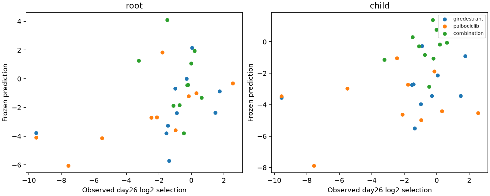
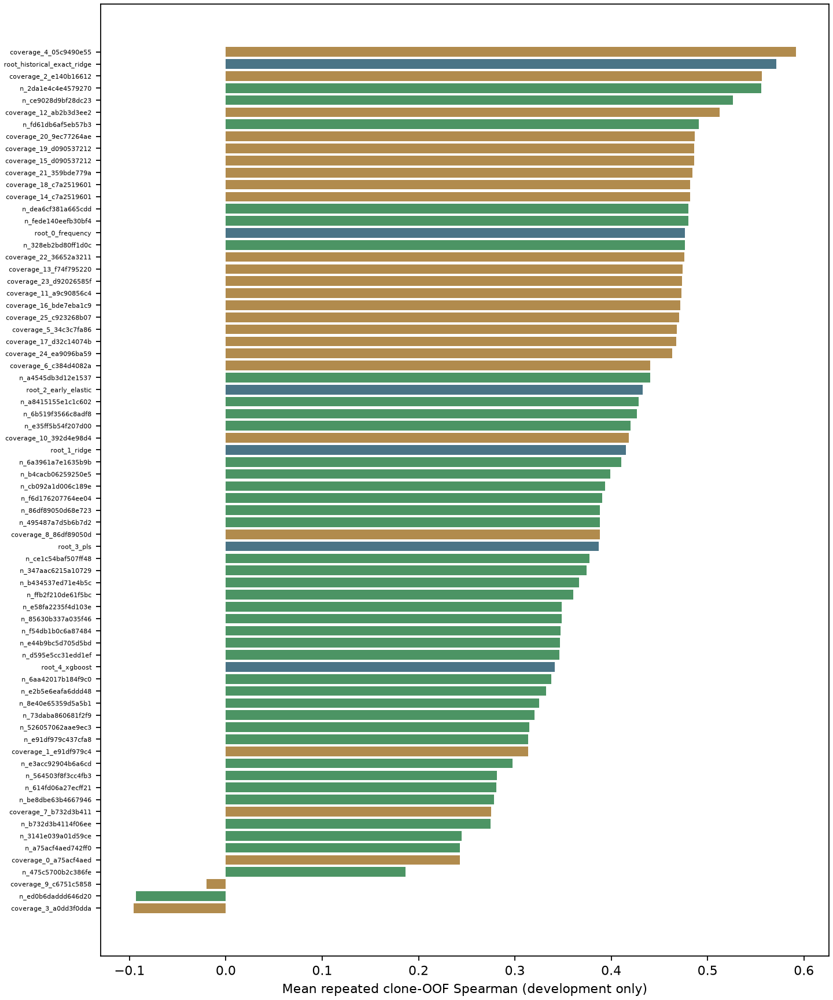

# T47D Shared-Protocol Formal Study v3

Retrospective public-data experiment. Previously exposed test groups are not new blind confirmation.

## Protocol

- Unit: clone x treatment; input days0/1/4; day26 smoothed log2 relative selection.
- Selection: five seeds x three clone-grouped OOF folds; reward is mean seed-level Spearman.
- Coverage and optimization have separate registered allocations. Neither is independent replication.
- Exact historical Ridge is an unchanged required benchmark, including category encoding/scaling.
- New neural candidates predict the response directly, without hidden in-sample Ridge residuals.
- Explicit residual/stacking candidates learn weights on grouped OOF predictions.
- Primary confirmation loads frozen weights/calibrators and performs zero refits.

## Results

| Kind | Node | Development rho | Confirmation rho | Confirmation MAE |
|---|---|---:|---:|---:|
| root | root_historical_exact_ridge | 0.5715 | 0.4894871539912125 | 2.2004 |
| child | coverage_4_05c9490e55 | 0.5918 | 0.2830125726712828 | 2.3972 |

## Counts

```json
{
  "candidate_queued": 47,
  "pruned_not_selected": 73,
  "trained": 72
}
```

## Node Relationships

```mermaid
graph TD
  coverage_0_a75acf4aed["coverage_0_a75acf4aed"]
  root_historical_exact_ridge --> coverage_0_a75acf4aed
  coverage_10_392d4e98d4["coverage_10_392d4e98d4"]
  root_historical_exact_ridge --> coverage_10_392d4e98d4
  coverage_11_a9c90856c4["coverage_11_a9c90856c4"]
  root_historical_exact_ridge --> coverage_11_a9c90856c4
  coverage_12_ab2b3d3ee2["coverage_12_ab2b3d3ee2"]
  root_historical_exact_ridge --> coverage_12_ab2b3d3ee2
  coverage_13_f74f795220["coverage_13_f74f795220"]
  root_historical_exact_ridge --> coverage_13_f74f795220
  coverage_14_c7a2519601["coverage_14_c7a2519601"]
  root_historical_exact_ridge --> coverage_14_c7a2519601
  coverage_15_d090537212["coverage_15_d090537212"]
  root_historical_exact_ridge --> coverage_15_d090537212
  coverage_16_bde7eba1c9["coverage_16_bde7eba1c9"]
  root_historical_exact_ridge --> coverage_16_bde7eba1c9
  coverage_17_d32c14074b["coverage_17_d32c14074b"]
  root_historical_exact_ridge --> coverage_17_d32c14074b
  coverage_18_c7a2519601["coverage_18_c7a2519601"]
  root_historical_exact_ridge --> coverage_18_c7a2519601
  coverage_19_d090537212["coverage_19_d090537212"]
  root_historical_exact_ridge --> coverage_19_d090537212
  coverage_1_e91df979c4["coverage_1_e91df979c4"]
  root_historical_exact_ridge --> coverage_1_e91df979c4
  coverage_20_9ec77264ae["coverage_20_9ec77264ae"]
  root_historical_exact_ridge --> coverage_20_9ec77264ae
  coverage_21_359bde779a["coverage_21_359bde779a"]
  root_historical_exact_ridge --> coverage_21_359bde779a
  coverage_22_36652a3211["coverage_22_36652a3211"]
  root_historical_exact_ridge --> coverage_22_36652a3211
  coverage_23_d92026585f["coverage_23_d92026585f"]
  root_historical_exact_ridge --> coverage_23_d92026585f
  coverage_24_ea9096ba59["coverage_24_ea9096ba59"]
  root_historical_exact_ridge --> coverage_24_ea9096ba59
  coverage_25_c923268b07["coverage_25_c923268b07"]
  root_historical_exact_ridge --> coverage_25_c923268b07
  coverage_2_e140b16612["coverage_2_e140b16612"]
  root_historical_exact_ridge --> coverage_2_e140b16612
  coverage_3_a0dd3f0dda["coverage_3_a0dd3f0dda"]
  root_historical_exact_ridge --> coverage_3_a0dd3f0dda
  coverage_4_05c9490e55["coverage_4_05c9490e55"]
  root_historical_exact_ridge --> coverage_4_05c9490e55
  coverage_5_34c3c7fa86["coverage_5_34c3c7fa86"]
  root_historical_exact_ridge --> coverage_5_34c3c7fa86
  coverage_6_c384d4082a["coverage_6_c384d4082a"]
  root_historical_exact_ridge --> coverage_6_c384d4082a
  coverage_7_b732d3b411["coverage_7_b732d3b411"]
  root_historical_exact_ridge --> coverage_7_b732d3b411
  coverage_8_86df89050d["coverage_8_86df89050d"]
  root_historical_exact_ridge --> coverage_8_86df89050d
  coverage_9_c6751c5858["coverage_9_c6751c5858"]
  root_historical_exact_ridge --> coverage_9_c6751c5858
  n_2da1e4c4e4579270["n_2da1e4c4e4579270"]
  n_dea6cf381a665cdd --> n_2da1e4c4e4579270
  n_3141e039a01d59ce["n_3141e039a01d59ce"]
  coverage_2_e140b16612 --> n_3141e039a01d59ce
  n_328eb2bd80ff1d0c["n_328eb2bd80ff1d0c"]
  coverage_15_d090537212 --> n_328eb2bd80ff1d0c
  n_347aac6215a10729["n_347aac6215a10729"]
  coverage_16_bde7eba1c9 --> n_347aac6215a10729
  n_475c5700b2c386fe["n_475c5700b2c386fe"]
  coverage_11_a9c90856c4 --> n_475c5700b2c386fe
  n_495487a7d5b6b7d2["n_495487a7d5b6b7d2"]
  coverage_19_d090537212 --> n_495487a7d5b6b7d2
  n_526057062aae9ec3["n_526057062aae9ec3"]
  n_fede140eefb30bf4 --> n_526057062aae9ec3
  n_564503f8f3cc4fb3["n_564503f8f3cc4fb3"]
  n_ce9028d9bf28dc23 --> n_564503f8f3cc4fb3
  n_614fd06a27ecff21["n_614fd06a27ecff21"]
  coverage_4_05c9490e55 --> n_614fd06a27ecff21
  n_6a3961a7e1635b9b["n_6a3961a7e1635b9b"]
  n_dea6cf381a665cdd --> n_6a3961a7e1635b9b
  n_6aa42017b184f9c0["n_6aa42017b184f9c0"]
  coverage_6_c384d4082a --> n_6aa42017b184f9c0
  n_6b519f3566c8adf8["n_6b519f3566c8adf8"]
  coverage_25_c923268b07 --> n_6b519f3566c8adf8
  n_73daba860681f2f9["n_73daba860681f2f9"]
  coverage_23_d92026585f --> n_73daba860681f2f9
  n_85630b337a035f46["n_85630b337a035f46"]
  coverage_18_c7a2519601 --> n_85630b337a035f46
  n_86df89050d68e723["n_86df89050d68e723"]
  n_328eb2bd80ff1d0c --> n_86df89050d68e723
  n_8e40e65359d5a5b1["n_8e40e65359d5a5b1"]
  coverage_15_d090537212 --> n_8e40e65359d5a5b1
  n_a4545db3d12e1537["n_a4545db3d12e1537"]
  coverage_19_d090537212 --> n_a4545db3d12e1537
  n_a75acf4aed742ff0["n_a75acf4aed742ff0"]
  coverage_21_359bde779a --> n_a75acf4aed742ff0
  n_a8415155e1c1c602["n_a8415155e1c1c602"]
  coverage_5_34c3c7fa86 --> n_a8415155e1c1c602
  n_b434537ed71e4b5c["n_b434537ed71e4b5c"]
  n_2da1e4c4e4579270 --> n_b434537ed71e4b5c
  n_b4cacb06259250e5["n_b4cacb06259250e5"]
  coverage_20_9ec77264ae --> n_b4cacb06259250e5
  n_b732d3b4114f06ee["n_b732d3b4114f06ee"]
  coverage_5_34c3c7fa86 --> n_b732d3b4114f06ee
  n_be8dbe63b4667946["n_be8dbe63b4667946"]
  coverage_14_c7a2519601 --> n_be8dbe63b4667946
  n_cb092a1d006c189e["n_cb092a1d006c189e"]
  root_0_frequency --> n_cb092a1d006c189e
  n_ce1c54baf507ff48["n_ce1c54baf507ff48"]
  coverage_17_d32c14074b --> n_ce1c54baf507ff48
  n_ce9028d9bf28dc23["n_ce9028d9bf28dc23"]
  coverage_13_f74f795220 --> n_ce9028d9bf28dc23
  n_d595e5cc31edd1ef["n_d595e5cc31edd1ef"]
  coverage_12_ab2b3d3ee2 --> n_d595e5cc31edd1ef
  n_dea6cf381a665cdd["n_dea6cf381a665cdd"]
  coverage_6_c384d4082a --> n_dea6cf381a665cdd
  n_e2b5e6eafa6ddd48["n_e2b5e6eafa6ddd48"]
  root_0_frequency --> n_e2b5e6eafa6ddd48
  n_e35ff5b54f207d00["n_e35ff5b54f207d00"]
  coverage_25_c923268b07 --> n_e35ff5b54f207d00
  n_e3acc92904b6a6cd["n_e3acc92904b6a6cd"]
  coverage_24_ea9096ba59 --> n_e3acc92904b6a6cd
  n_e44b9bc5d705d5bd["n_e44b9bc5d705d5bd"]
  coverage_25_c923268b07 --> n_e44b9bc5d705d5bd
  n_e58fa2235f4d103e["n_e58fa2235f4d103e"]
  coverage_14_c7a2519601 --> n_e58fa2235f4d103e
  n_e91df979c437cfa8["n_e91df979c437cfa8"]
  coverage_22_36652a3211 --> n_e91df979c437cfa8
  n_ed0b6daddd646d20["n_ed0b6daddd646d20"]
  coverage_17_d32c14074b --> n_ed0b6daddd646d20
  n_f54db1b0c6a87484["n_f54db1b0c6a87484"]
  coverage_21_359bde779a --> n_f54db1b0c6a87484
  n_f6d176207764ee04["n_f6d176207764ee04"]
  coverage_11_a9c90856c4 --> n_f6d176207764ee04
  n_fd61db6af5eb57b3["n_fd61db6af5eb57b3"]
  n_dea6cf381a665cdd --> n_fd61db6af5eb57b3
  n_fede140eefb30bf4["n_fede140eefb30bf4"]
  coverage_20_9ec77264ae --> n_fede140eefb30bf4
  n_ffb2f210de61f5bc["n_ffb2f210de61f5bc"]
  coverage_13_f74f795220 --> n_ffb2f210de61f5bc
  root_0_frequency["root_0_frequency"]
  root_1_ridge["root_1_ridge"]
  root_2_early_elastic["root_2_early_elastic"]
  root_3_pls["root_3_pls"]
  root_4_xgboost["root_4_xgboost"]
  root_historical_exact_ridge["root_historical_exact_ridge"]
```



## Interpretation

Selected child phase: coverage.
Best optimization-only child: n_2da1e4c4e4579270.
Report the paired development confidence interval, not only a winner score. A null result is valid.
Adaptive development evidence, fixed secondary analyses and historically exposed confirmation have different evidential strength.
This run does not by itself establish that the general framework transfers to independent tasks.


## Compute And Cost

- GPU: NVIDIA RTX 2000 Ada Generation, 16380 MiB
- Experiment wall time: 6.735 hours.
- One-GPU reserved experiment hours (not GPU-utilization hours): 6.735.
- Approximate experiment GPU plus container cost: $1.663.
- New persistent volume: $7/month recurring until deleted; setup/copy overhead is additional.
- Allocation stops at 2026-11-09T17:15:00+00:00; this is not permission to extend compute.

## Complete-Scope Outputs

- research_protocol.json: present
- research_budget.json: present
- eight_ablations.json: present
- temporal_snapshot_control.json: present
- early_abundance_baseline.json: present
- loco_results.json: present
- challenge_metrics.json: present
- reference/reference_data.json: present
- biological_and_sensitivity_analysis.json: present
- resistance_attractor_and_month6.json: present
- denominator_null_diagnostic.json: present




